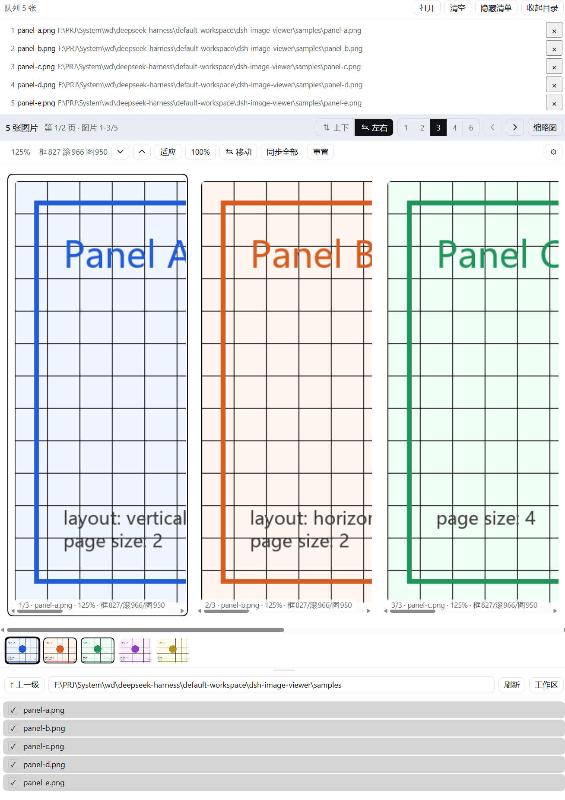
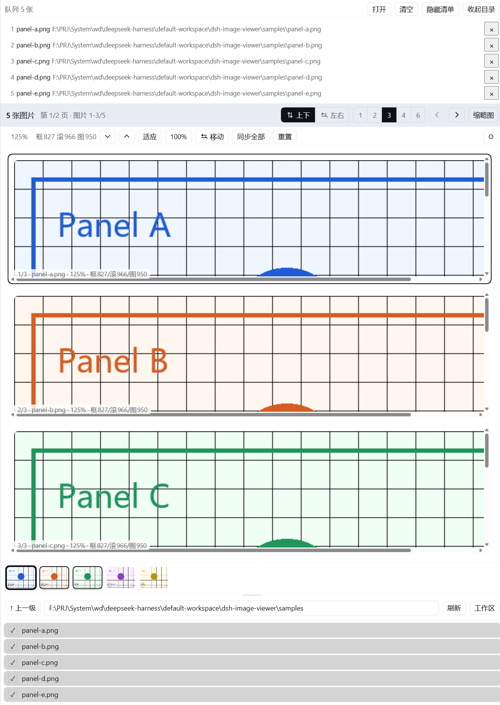

# dsh-image-compare

[English](README.en.md)

**在侧边栏里同时对比查看多张图片**的 DeepSeek Harness 插件。

想在 DSH 里对照"改前 vs 改后"、横向比五个方案的截图，原来只能一张张点开、来回翻。装上这个插件后，右栏会多出一个「**图片查看器**」面板：

```
侧边栏 → 图片查看器 → 勾选几张图 → 点「打开」→ 并排对比
```

一页放 1/2/3/4/6 张、任意放大拖动、拖动缩略图改顺序，而且**整组同步**——把当前这张的缩放和位置一键应用到其他所有图，于是每张都停在"同一处内容"，细节对比才真正对得齐。

图片只给你看，**不进模型上下文**：摆 20 张 2MB 的截图，对话里也不会多一个字。

<table>
  <tr>
    <td align="center" width="50%">
      <br>
      <sub>左右安排 · 每页 3 张</sub>
    </td>
    <td align="center" width="50%">
      <br>
      <sub>上下安排 · 每页 3 张</sub>
    </td>
  </tr>
</table>

<sub>同一组五张图，只是换了安排方式；两边都在 125%，底部缩略图条可拖动改顺序。</sub>

## 主要功能

**对比多张图**（核心）

- **一页并排 1/2/3/4/6 张**（默认 2 张）——真正左右/上下对照，而不是来回滚动。
- **整组同步**：把当前这张的**缩放和显示位置**一起应用到全部图片，每张都显示"同一处内容"——对比细节时这才是真正对齐。
- **任意排序**：拖动底部缩略图即可调整顺序，把要对照的两张放到一起。

**看图**

- **每张独立缩放**：点选某张，缩放行只作用于它，范围 0.1x–8x；双击在放大与适应之间切换。
- **中键拖动平移**：位移与鼠标一比一，松手即停；按住 `Shift` 则整组一起平移。
- **上下 / 左右翻页**：滚轮、方向键、上一页/下一页按钮都能翻，滚轮一次正好翻一页。
- **缩略图条**：点任意一张跳到它所在的页。

**取图**

- **面板内直接浏览工作区**：上级目录、路径框、刷新、勾选多张后一起打开。本地会话列本地，SSH 会话列远程。
- **路径读不出会说明原因**：越界 / 不是图片 / 找不到，分别给出提示，而不是一个裂图。

## 安装

插件是标准的 DSH profile 组合包，包内自带全部声明，**不需要手写任何配置文件**。

### 插件页面（推荐）

1. 打开 Web 界面，左侧栏点 **插件**；
2. 点 **添加插件**，粘贴以下任一种：
   - `github:ChordXD/dsh-image-compare`
   - 本地目录的**绝对路径**
   - npm 包名（发布后）
3. 确认它处于**启用**状态；
4. **重启 DeepSeek Harness**。

### 命令行

```sh
dsh plugin --profile web add github:ChordXD/dsh-image-compare
```

包内没有任何构建步骤（纯 JS，`package.json` 里没有 `scripts`），所以通常装上即用。如果 dsh 仍然提示 `allowBuilds`，按它的提示把给出的键名加进该 profile 的 `pnpm-workspace.yaml` 再重跑即可。想锁定版本就带上 commit：`github:ChordXD/dsh-image-compare#<sha>`。

### 卸载

在插件页面移除，或 `dsh plugin --profile web remove dsh-image-compare`，然后重启。

> 环境：DeepSeek Harness 0.2.0-rc.2 及以上（Web 界面 / 桌面版）。**不需要安装任何依赖**——宿主半边用 profile 提供的服务，客户端只用 shell 预载的 `react`。

## 使用

### 打开面板

右栏的每个标签页都能贡献一个**启动页入口**。打开右栏的启动页（引导页），在入口列表里选「**图片查看器**」，面板就作为标签页出现；打开一次后它是常驻标签，之后点标签即可回到对比视图。

### 选图并打开

面板从上到下分三段：

```
┌────────────────────────────────────────────┐
│ 队列 N 张  [打开] [清空] [隐藏清单] [收起目录]   │
│ ⠿ 1  before.png   /data/…/before.png    ×   │ ← 勾选即入队，× 移出
├────────────────────────────────────────────┤
│                图片区（占满剩余高度）             │ ← 对比就在这里看
│   …… 底部缩略图条：拖动缩略图即可改变顺序 ……      │
├────────────────────────────────────────────┤
│ ↑上一级  /data/…/eval        [刷新] [工作区]   │ ← 目录浏览器，高度可拖
│ ✓ results.png    ☐ baseline.png             │
└────────────────────────────────────────────┘
```

1. 在最下面的**目录浏览器**里勾选想看的图（勾选只是入队，此时屏幕上什么都不变）；
2. 需要的话拖一下目录区上方的**分隔条**，把它调大好找文件；路径框可以直接编辑，回车跳转；
3. 点 **「打开」**——画面上出现第一张；
4. 想调整对比顺序，就**拖动底部缩略图**。

### 对比操作

- 点一下某张图把它**选中**（蓝框），缩放行的按钮和读数就作用于它；
- `Ctrl`/`Cmd` + 滚轮放大它，然后**中键拖动**平移；
- 对好位置后点「**同步全部**」——其他所有图立刻跳到同一处内容；
- 想整组一起挪，`Shift` + 中键拖动；想整组一起缩放，`Ctrl`/`Cmd` + `Shift` + 滚轮。

## 操作

鼠标（图片区内）：

| 手势 | 作用 |
| --- | --- |
| 左键点击 | 选中这张图 |
| `Ctrl` / `Cmd` + 滚轮 | 缩放指针下那张（以指针为锚点） |
| `Ctrl` / `Cmd` + `Shift` + 滚轮 | 把当前那张的缩放与位置**同步到整组** |
| 中键拖动 | 平移这张放大的区域 |
| `Shift` + 中键拖动 | 整组一起平移 |
| 滚轮（无修饰键） | 翻页，一格一页 |
| 双击图片 | 放大 ↔ 回到适应 |
| 拖动缩略图 | 调整图片顺序 |

缩放行（图片区上方）：百分比读数、`−`、`+`、`适应`、`100%`、`移动`、`同步全部`、`重置`、`⚙`（设置）。

键盘：

| 按键 | 作用 |
| --- | --- |
| `↑` `↓` | 上一页 / 下一页（上下翻页时） |
| `←` `→` / `PageUp` `PageDown` | 上一页 / 下一页（两种翻页方向都可） |
| `Home` / `End` | 第一页 / 最后一页 |
| `+` / `-` | 放大 / 缩小选中的那张（「移动」模式下作用于整组） |
| `0` | 全部回到默认缩放 |
| `V` | 切换上下 / 左右翻页 |
| `2`–`6` | 每页 1 / 2 / 3 / 4 / 6 张 |
| `F` | 显示 / 隐藏缩略图条 |
| `Esc` | 关闭全屏浮层（面板里没有浮层，`Esc` 不做任何事） |

齿轮里可以设置：默认缩放、每页张数、是否默认展开缩略图条、查看器字号、单张图片最小高度，以及是否显示诊断信息（默认关闭；它会在缩放行显示每张图的实测尺寸，并在设置里列出完整测量数据，排查显示问题时才需要）。同一页的图片会平分可用高度，所以这个下限会自动让位于更挤的一页，不会把图片挤出画面。

## 与其他看图插件的区别

| | 看图对象 | 一次看几张 | 图片是否进模型上下文 |
| --- | --- | --- | --- |
| DSH 内置 `read_image` | 模型 | 1 张 | 是 |
| 增强内置查看器的插件 | 已渲染的图 | 1 张为主 | 否 |
| 视觉模型桥接类插件 | **模型** | 多张 | **是**（消耗视觉额度） |
| **本插件** | **人眼** | **一组，并排可翻页** | **否** |

一句话：它是**给人做多图对比**的工具，不是给模型读图的通道。图片全部由浏览器直接向本插件的只读路由取，模型既不读字节也不经手。

## 后续计划

- **让模型直接打开一组图**：现在图片只能从面板的目录浏览器里选。计划恢复一个模型可调用的工具（形如 `view_images(images, layout, page_size, title)`），把这组图直接发布到右栏面板，省掉手动选图。上一版做过，但对话卡片上的入口按钮无法稳定打开右栏面板，所以先撤下、把这一版的面板做扎实。

## 许可

MIT
